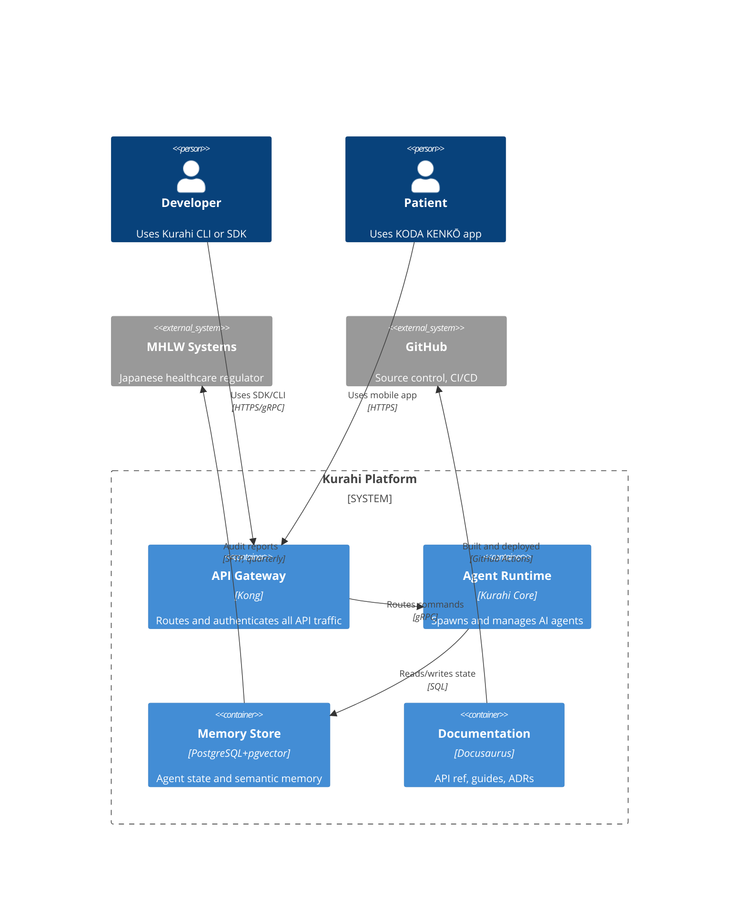

# Architecture Documentation

## Overview

Architecture documentation at Kurahi captures the "why" behind technical decisions, not just the "what." We use Architecture Decision Records (ADRs) as our primary tool, integrated with the architecture-governance skill for compliance, and the C4 model for system visualization.

## Architecture Decision Records (ADR)

### ADR Format

Every architectural decision that affects system structure, technology choice, or significant design pattern gets an ADR. Our format extends Michael Nygard's standard with Kurahi-specific compliance fields:

```markdown
---
adr: 42
title: "Use PostgreSQL as Primary Data Store for Agent State"
status: accepted # proposed | accepted | deprecated | superseded
date: 2026-05-20
deciders: ["CTO", "Systems", "Platform"]
supersedes: []
superseded_by: []
compliance:
  mhlw_applicable: false
  pii_scope: none
  audit_required: false
  gdpr_relevant: false
  japan_cloud_only: true
architecture_governance:
  domain: data-storage
  principle_refs: ["P004-data-sovereignty", "P007-operational-simplicity"]
---

# ADR-0042: Use PostgreSQL as Primary Data Store for Agent State

## Context

The agent runtime requires persistent storage for agent memory state,
conversation history, and execution logs. Current implementation uses
in-memory storage with file-based snapshots, which causes data loss on
unexpected crashes and limits multi-node agent migration.

## Decision

We will use PostgreSQL 16+ with the `pgvector` extension as the primary
data store for all agent state and memory.

## Rationale

1. **Operational maturity**: PostgreSQL is well-understood by the team,
   has mature tooling, and straightforward backup/restore.
2. **Vector support**: pgvector enables semantic memory queries without
   introducing a separate vector database.
3. **Data sovereignty**: Self-hosted PostgreSQL on Japan-based infrastructure
   satisfies `P004-data-sovereignty` requirements for KODA KENKŌ data.
4. **ACID guarantees**: Agent state transitions require transactional integrity.

## Alternatives Considered

| Option                 | Pros                                | Cons                                     | Why Rejected                                  |
| ---------------------- | ----------------------------------- | ---------------------------------------- | --------------------------------------------- |
| MongoDB                | Flexible schema, horizontal scale   | Eventual consistency, no native JOINs    | ACID requirement for agent state transitions  |
| Redis + file snapshots | Extremely fast, current pattern     | Data loss window, operational complexity | Unacceptable durability for memory state      |
| CockroachDB            | Multi-region, PostgreSQL-compatible | Operational complexity, newer ecosystem  | Overkill for current single-region deployment |

## Consequences

### Positive

- Single data store reduces operational surface area
- ACID transactions simplify agent state management
- pgvector enables new semantic search capabilities

### Negative

- PostgreSQL is not horizontally scalable by default; need to plan for sharding if agent count exceeds ~10,000
- Migration from file-based snapshots requires a one-time downtime window

### Mitigations

- Implement connection pooling (PgBouncer) from day one
- Design schema with future partitioning in mind
- Schedule migration during planned maintenance window

## Compliance Notes

- Not MHLW applicable (agent infrastructure, not clinical data)
- No PII storage in agent state tables (stored in separate encrypted store)
- Japan cloud-only: PostgreSQL hosted on Sakura Cloud Tokyo region

## Related

- ADR-0038: Vector Search Strategy
- ADR-0040: Agent Memory Model v2
- Architecture principle P004: Data Sovereignty
- Architecture principle P007: Operational Simplicity
```

### ADR Status Lifecycle

```
proposed → accepted → (deprecated | superseded)
                ↓
            implemented (tracked in issue tracker, not ADR status)
```

- **proposed**: Open for discussion, not yet decided
- **accepted**: Decision made, in effect
- **deprecated**: No longer applies (technology removed, approach obsolete)
- **superseded**: Replaced by a newer ADR (must link to the superseding ADR)

### When to Write an ADR

Write an ADR for decisions that are:

- **Structural**: Changes to system architecture, data models, or API boundaries
- **Costly to reverse**: Technology choices, protocol decisions, schema designs
- **Cross-team**: Affecting multiple components or teams
- **Compliance-relevant**: Decisions with MHLW, GDPR, or security implications

Don't write ADRs for:

- Routine code patterns within a module
- Bug fixes or minor refactors
- Decisions reversible in < 1 day of work

## System Diagrams (C4 Model)

### C4 Levels We Use

| Level  | Name              | Audience             | Purpose                                                                |
| ------ | ----------------- | -------------------- | ---------------------------------------------------------------------- |
| **L1** | System Context    | Everyone             | One diagram: Kurahi in the world. Users, external systems, data flows. |
| **L2** | Container Diagram | Technical team       | Kurahi's runtime containers (API, Gateway, Agent Runtime, Data Store)  |
| **L3** | Component Diagram | Development team     | Inside each container: modules, services, key abstractions             |
| **L4** | Code Diagram      | Team within a module | Class/resource diagrams for complex internals                          |

### Diagram Tooling

- **Primary**: Structurizr DSL (text-based, version-controlled, generates C4 diagrams)
- **Quick sketches**: Mermaid (embedded in Markdown, GitHub-renderable)
- **Formal submissions**: Structurizr → PNG export → embedded in docs

### C4 Diagram Example (Mermaid — L2 Container)



## README Standards

Every repository must have a README.md that answers:

1. **What is this?** (one sentence)
2. **Why does it exist?** (one paragraph)
3. **Quick start** (5 minutes to first working output)
4. **Architecture diagram** (at least L1 system context)
5. **Link to full documentation** (not everything in README)
6. **Contributing guide** link
7. **License and compliance** badges (MHLW-approved, GDPR-ready, etc.)

### README Template

````markdown
# Project Name

> One-line description of what this project does.

## Why

One paragraph explaining the problem this solves and why it exists.

## Quick Start

```bash
git clone ...
cd project
make setup
make run
```
````

Open http://localhost:3000

## Architecture


[Full architecture documentation →](docs/architecture/README.md)

## Documentation

- [API Reference](https://docs.kolo.dev/api)
- [Architecture Decisions](docs/architecture/adr/)
- [Contributing Guide](CONTRIBUTING.md)

## Compliance


````

## Onboarding Documentation

New developer onboarding docs must cover:

1. **Environment setup** — automated via script, not prose
2. **Architecture overview** — L1 + L2 C4 diagrams
3. **Key ADRs** — the 10 most important decisions, why they matter
4. **Development workflow** — branch strategy, PR process, CI/CD
5. **First task** — pre-scoped, well-documented, completable in 1 day
6. **Glossary** — internal terminology, acronyms, Kurahi-specific concepts

## Decision History (ADR Index)

Maintain an ADR index file that stays current:

```markdown
# Architecture Decision Records

| ADR | Title | Status | Date | Domain |
|-----|-------|--------|------|--------|
| 42 | Use PostgreSQL as Primary Data Store | accepted | 2026-05-20 | data-storage |
| 41 | Adopt gRPC for Inter-Service Communication | accepted | 2026-05-15 | communication |
| 40 | Agent Memory Model v2 | accepted | 2026-05-10 | agent-runtime |
| 39 | MHLW Audit Data Export Format | accepted | 2026-05-01 | compliance |
| 38 | Vector Search Strategy | superseded by 42 | 2026-04-20 | data-storage |
````

## Technical Specifications

### Spec Document Structure

For formal technical specifications (RFC-style):

```
1. Motivation and Scope
   1.1 Problem Statement
   1.2 Out of Scope
2. Proposed Design
   2.1 System Overview (diagram)
   2.2 Data Model
   2.3 API Design
   2.4 Security Considerations
   2.5 Performance Budget
3. Implementation Plan
   3.1 Phases and Milestones
   3.2 Migration Strategy
   3.3 Rollback Plan
4. Open Questions
5. References (ADRs, prior specs, external standards)
```

### Compliance Annotation in Specs

For KODA KENKŌ specifications, annotate regulatory implications:

> **MHLW Notice 0310 compliance:** This specification adheres to MHLW Notice No. 0310
> (2023) for medical information systems. Section 2.4 (Security) implements the
> six requirements from Article 3, Paragraph 2.

## Integration with Architecture Governance

When the architecture-governance skill is available, ADRs link to governance principles via the `architecture_governance.principle_refs` field. The governance skill validates that:

1. New ADRs don't violate existing principles
2. Principle changes trigger ADR review for affected decisions
3. Compliance annotations in ADRs match the regulatory inventory

## Tooling

- **ADR CLI**: `adr new "Title"` — scaffolds a new ADR from template
- **Structurizr CLI**: `structurizr push` — publishes C4 diagrams
- **Mermaid**: GitHub-native rendering for diagrams in Markdown
- **Architecture lint**: CI check that ADR index is current, diagram links resolve, and statuses are consistent
